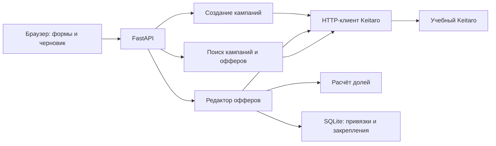

# Архитектура Keitaro Wrapper

Один процесс FastAPI обслуживает интерфейс и JSON API. Браузер вызывает обёртку, а запросы с ключом Keitaro выполняет сервер. [Решение о структуре приложения](decisions/0001-keitaro-wrapper-single-process.md)

| Часть | Как работает | Код |
| --- | --- | --- |
| Создание | Записывает выключенную кампанию, проверяет домен, группу, источник и оба потока обратным чтением, затем включает кампанию. | [app/campaigns.py](../app/campaigns.py) |
| Редактор | Читает актуальный состав, рассчитывает черновик и перед отправкой проверяет версию потока. После записи сверяет результат с Keitaro. | [app/editor.py](../app/editor.py) · [app/editor_weights.py](../app/editor_weights.py) |
| Состояние | Keitaro задаёт активные офферы и их веса. SQLite хранит известные пары «поток — оффер» и факт закрепления. Черновик живёт во вкладке. | [app/storage.py](../app/storage.py) · [app/static/editor.js](../app/static/editor.js) · [Миграция](../migrations/versions/0001_stream_offer_memory.py) |
| Поиск | Сервер возвращает до 20 пар ID и названия. Поиск офферов ограничен активными офферами, поиск кампаний — настроенным тестовым префиксом. | [app/selection.py](../app/selection.py) |

Описание поведения и сценариев находится в [спецификации кампаний](specs/campaign/spec.md) и [спецификации редактора](specs/editor/spec.md). Проверки и обоснования решений описаны в [TRACE.md](../TRACE.md).
