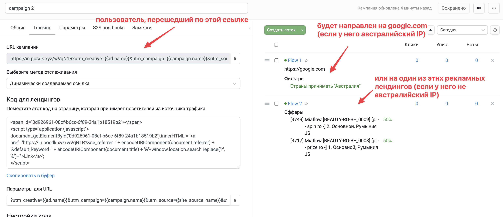
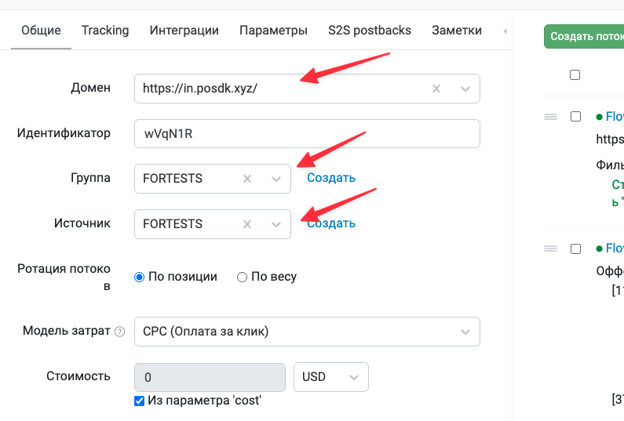
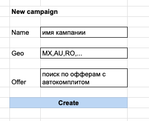
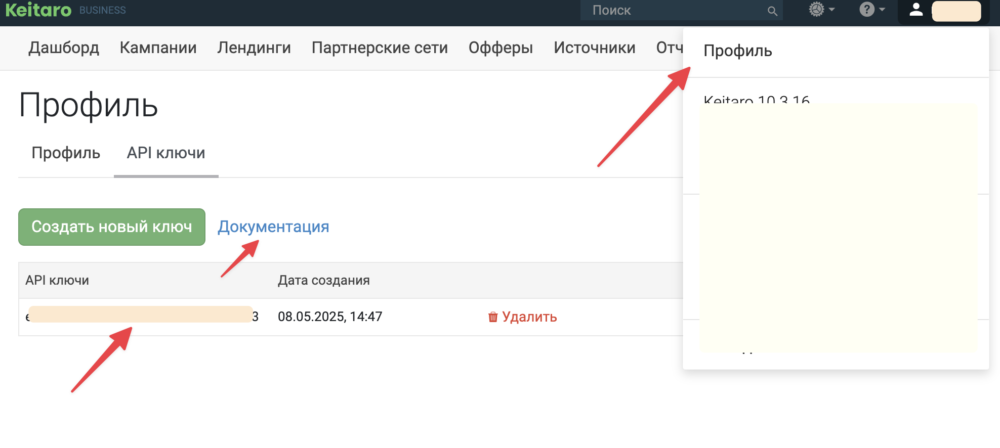

# Adrobot ТЗ

[Исходная страница Notion](https://app.notion.com/p/mnovikov/Adrobot-2b01eb78a7bb80a1b188c3a4a1cad55e)

Копия исходного задания. Ссылки «Блок Notion» ведут на соответствующие места в источнике. Дата выгрузки — 24 ноября 2026 года.

Это тестовое задание покажет вам пример одной из систем, с которой мы работаем. [Блок Notion](https://app.notion.com/p/mnovikov/Adrobot-2b01eb78a7bb80a1b188c3a4a1cad55e#2b01eb78a7bb80b28255fc87957299fe)

Эта система - рекламный трекер Keitaro, с его помощью мы отслеживаем прибыльность наших рекламных объявлений. С технической точки зрения - это конструктор ссылок, который редиректит пришедших пользователей согласно настроенным правилам, а потом показывает статистику редиректов, например: [Блок Notion](https://app.notion.com/p/mnovikov/Adrobot-2b01eb78a7bb80a1b188c3a4a1cad55e#2b01eb78a7bb802b8643fbfb43d31bca)

[Блок Notion](https://app.notion.com/p/mnovikov/Adrobot-2b01eb78a7bb80a1b188c3a4a1cad55e#2b01eb78a7bb80e0ab2ff35467d349c5)

Ваша задача состоит из 2 частей: [Блок Notion](https://app.notion.com/p/mnovikov/Adrobot-2b01eb78a7bb80a1b188c3a4a1cad55e#2b01eb78a7bb807faa7effcf7270113e)

## 1. Написать “создаватор” кампаний.

[Блок Notion](https://app.notion.com/p/mnovikov/Adrobot-2b01eb78a7bb80a1b188c3a4a1cad55e#2b01eb78a7bb80b4a34acf0a91df5071)

Он должен принимать название кампании, гео-код страны и ID оффера Keitaro и создавать кампанию, которая: [Блок Notion](https://app.notion.com/p/mnovikov/Adrobot-2b01eb78a7bb80a1b188c3a4a1cad55e#2b01eb78a7bb80c19bf0d982cb94f02e)

- имеет 2 потока: первый поток ловит всех из указанной страны и редиректит на гугл, второй поток редиректит на выбранный оффер [Блок Notion](https://app.notion.com/p/mnovikov/Adrobot-2b01eb78a7bb80a1b188c3a4a1cad55e#2b01eb78a7bb8095a309d4a1973aa9e6)

- имеет настроенные домен, группу и источник (все это тоже есть в API). [Блок Notion](https://app.notion.com/p/mnovikov/Adrobot-2b01eb78a7bb80a1b188c3a4a1cad55e#2b01eb78a7bb80709ffee587c7e299b3)

  

  [Блок Notion](https://app.notion.com/p/mnovikov/Adrobot-2b01eb78a7bb80a1b188c3a4a1cad55e#2b01eb78a7bb806983b3e9071384c2e6)

Вот примерный интерфейс: [Блок Notion](https://app.notion.com/p/mnovikov/Adrobot-2b01eb78a7bb80a1b188c3a4a1cad55e#2b01eb78a7bb80d29f1fca935bb0abca)

[Блок Notion](https://app.notion.com/p/mnovikov/Adrobot-2b01eb78a7bb80a1b188c3a4a1cad55e#2b01eb78a7bb804d8629e6eca3755ba4)

## 2. Написать редактор существующей кампании.

[Блок Notion](https://app.notion.com/p/mnovikov/Adrobot-2b01eb78a7bb80a1b188c3a4a1cad55e#2b01eb78a7bb80e692efe6da244ced28)

Редактор должен уметь добавлять/удалять офферы в кампании. Этот редактор у нас уже есть, ниже - видео, как это выглядит и как работает. Вам нужно воспроизвести эту логику. Интерфейс - делайте на ваш вкус, главное, чтобы кнопки работали и цифры были верные. [Блок Notion](https://app.notion.com/p/mnovikov/Adrobot-2b01eb78a7bb80a1b188c3a4a1cad55e#2b01eb78a7bb8078a9fee6531b33ab79)

[keitaro wrapper - test](https://youtu.be/jNloscEWCjA) · [Блок Notion](https://app.notion.com/p/mnovikov/Adrobot-2b01eb78a7bb80a1b188c3a4a1cad55e#2b01eb78a7bb8041accec246ddf851d5)

[Локальная копия видео, 6:13](source-assets/campaign-editor-reference.mp4) · [Автоматические русские субтитры YouTube с таймкодами](source-assets/campaign-editor-reference.ru.json3).

## Документация и API ключ

[Блок Notion](https://app.notion.com/p/mnovikov/Adrobot-2b01eb78a7bb80a1b188c3a4a1cad55e#2b01eb78a7bb80769589f662639f2382)

Документация к API Keitaro и ключ доступны в админке Keitaro. [Блок Notion](https://app.notion.com/p/mnovikov/Adrobot-2b01eb78a7bb80a1b188c3a4a1cad55e#2b01eb78a7bb80599036f801d43a6041)

[Блок Notion](https://app.notion.com/p/mnovikov/Adrobot-2b01eb78a7bb80a1b188c3a4a1cad55e#2b01eb78a7bb80269fa6c0ecd8ef31e8)

## Как сдавать тестовое

[Блок Notion](https://app.notion.com/p/mnovikov/Adrobot-2b01eb78a7bb80a1b188c3a4a1cad55e#2b01eb78a7bb80cd8880f78b0d75a1fa)

Проект должен быть написан на FastApi + SQLAlchemy. Фронт - можно сделать любой, хоть React, хоть HTML-ки с кусками jquery. [Блок Notion](https://app.notion.com/p/mnovikov/Adrobot-2b01eb78a7bb80a1b188c3a4a1cad55e#2b01eb78a7bb8035a69dcd001bd93d5b)

Сдавать работу в виде ссылки на гитхабе с понятным README для миграций и запуска. Использование агентов типа Cursor/Windsurf категорически приветствуется. [Блок Notion](https://app.notion.com/p/mnovikov/Adrobot-2b01eb78a7bb80a1b188c3a4a1cad55e#33e1eb78a7bb8059bd87e276bb0c2281)

## Условия из сообщения к заданию

Эти сведения предоставлены вместе со ссылкой на полное ТЗ.

- Срок — 5 дней.
- [Админка эмулятора Keitaro](https://keitaro-for-tests.etolegko.com/admin/). Вход через GitHub.
- Называй кампании с префиксом `test_фамилия_`, например `test_ivanov_campaign1`.
- Сдача — ссылка на публичный репозиторий GitHub. В README должна быть инструкция по миграциям и запуску.
- В форме сдачи требуется развёрнутый ответ на вопрос «Как ты использовал ИИ-агентов?».
- Вопрос формы «Что не успел или что бы доделал?».
- Скринкаст по желанию, до 3 минут. Можно записать с экрана или загрузить файл.

## Снимок документации эмулятора

[OpenAPI учебного Keitaro, сохранённая 24 ноября](source-assets/keitaro-emulator-openapi.json) · [Схема на учебном сервере](https://keitaro-for-tests.etolegko.com/openapi.json).
